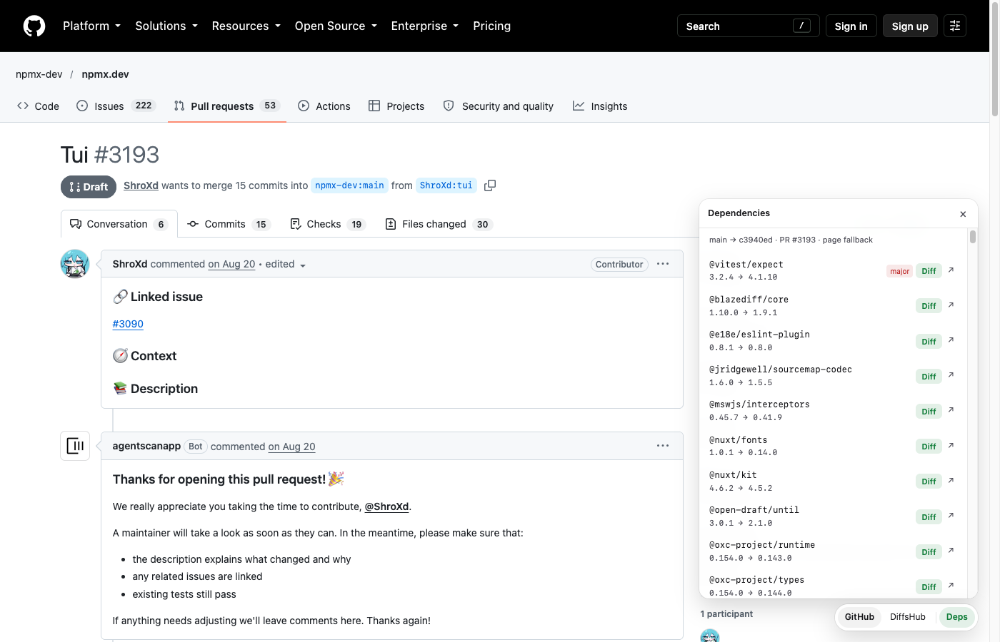

# Better Site

A small Chrome extension that links four sites so you can jump between them and
keep your place: GitHub ↔ [DiffsHub](https://diffshub.com) and npm ↔ [npmx](https://npmx.dev).



## What it does

- Shows a small floating bar on supported pages; click to switch site.
- `Alt+Shift+D` — switch GitHub and DiffsHub.
- `Alt+Shift+N` — switch npm and npmx.
- `Alt+Shift+B` — open the tools panel.
- Keeps the file and line you were reading, and lets you go back where you came from.
- Lists dependency updates in a diff, each with a link to the npmx version diff.
- Links an npmx version page to the matching DiffsHub commit.

## Install

```bash
curl -fsSL https://upm.sh/install.sh | sh
upm install
upm run build
```

Open `chrome://extensions`, turn on Developer mode, click Load unpacked, and
pick the `dist` folder.

## Settings

The dependency list asks GitHub for data, which is limited to 60 requests an hour
without a token. Add a fine-grained token into the settings page for exact results.

## Releasing

```bash
upm run release
```

That bumps the three files that carry the version, commits, tags, and pushes.
Pushing the tag makes CI build the zip and publish a GitHub Release.

## License

MIT
